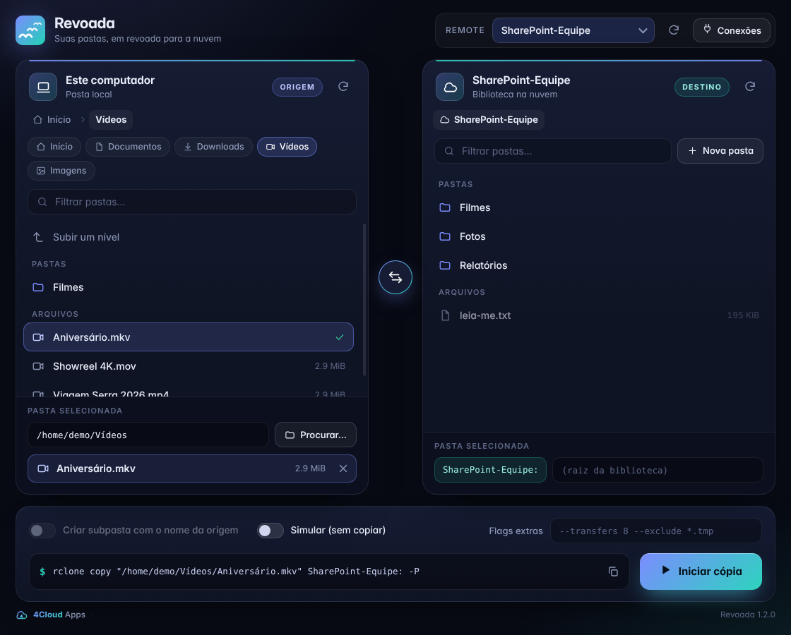
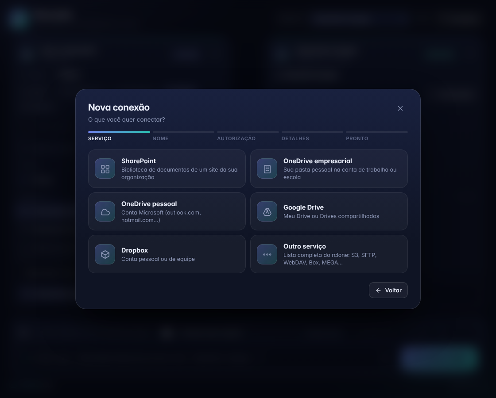
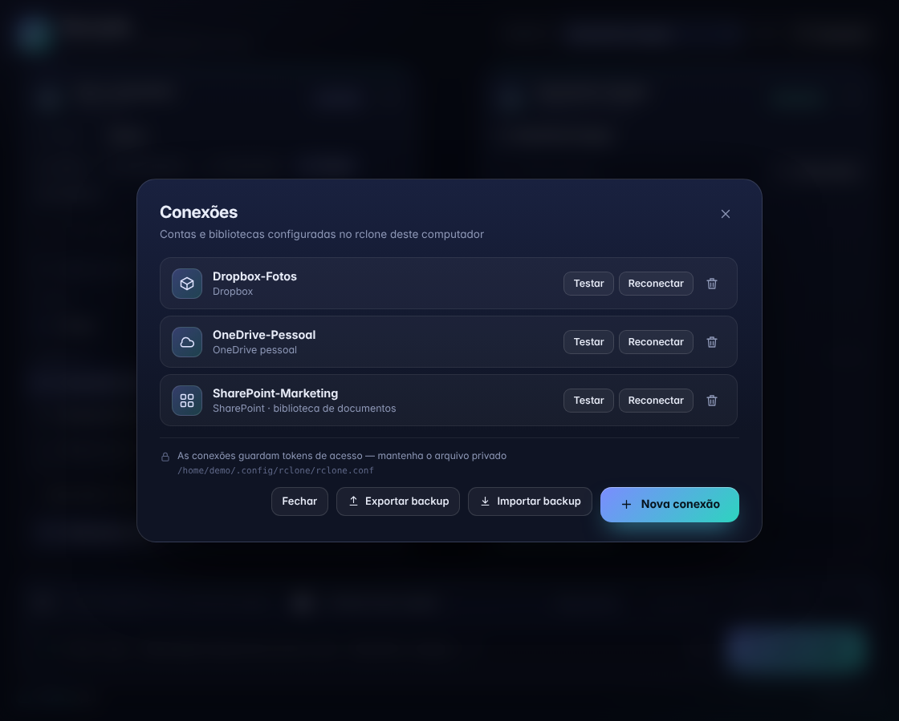
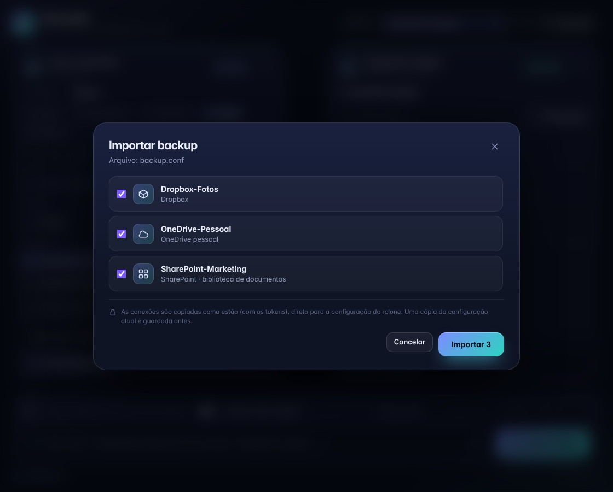

<p align="center">
  
</p>

<h1 align="center">Revoada</h1>

<p align="center">
  <b>Suas pastas, em revoada para a nuvem.</b><br>
  Uma interface visual e elegante para copiar arquivos entre o seu computador e o SharePoint, OneDrive, Google Drive, Dropbox e dezenas de outros serviços, usando o poderoso <a href="https://rclone.org">rclone</a>.
</p>

<p align="center">
  <a href="https://github.com/psychookov/revoada/releases/latest"></a>
  <a href="https://psychookov.github.io/revoada/"></a>
</p>

<p align="center">
  
  
  
</p>

<p align="center">
  
</p>

## O que é

O Revoada **não substitui o rclone**: ele é uma casca visual por cima dele. Tudo o que você faria no terminal com

```bash
rclone copy "/home/voce/Vídeos/Filmes" "media-sharepoint:Filmes" -P
```

vira dois painéis lado a lado: de um lado o seu computador, do outro a nuvem. Você navega, escolhe a origem e o destino, vê o comando exato que será executado e acompanha a cópia em tempo real. Nada é escondido: o comando do rclone aparece sempre na tela e pode ser copiado.

## Recursos

- **Dois painéis, pastas e arquivos.** Navegue pelo computador e pela nuvem lado a lado. Escolha uma pasta inteira ou **um único arquivo** como origem.
- **Direção em um clique.** Troque origem e destino (subir ou baixar) com o botão do meio.
- **Comando transparente.** O `rclone copy ...` que será executado é mostrado e pode ser copiado. Dá para acrescentar flags extras (`--transfers 8`, `--exclude *.tmp`...).
- **Simulação.** Marque *Simular* para ver o que seria copiado, sem copiar nada (`--dry-run`).
- **Progresso ao vivo.** Velocidade, tempo restante, porcentagem e os arquivos em transferência.
- **Conexões dentro do app.** Crie conexões com **SharePoint, OneDrive (empresarial e pessoal), Google Drive, Dropbox** ou qualquer outro serviço do rclone, com um assistente guiado e login pelo navegador. Teste, reconecte ou remova cada conexão.
- **Backup da configuração.** *Exporte* o seu `rclone.conf` antes de formatar o computador e *importe-o* depois, escolhendo quais conexões restaurar.
- **Pasta nova no destino**, com criação automática quando a cópia começa.
- **Sem telemetria.** O app só conversa com o rclone instalado na sua máquina.

## Capturas de tela

<table>
  <tr>
    <td></td>
    <td></td>
  </tr>
  <tr>
    <td align="center"><sub>Assistente de nova conexão</sub></td>
    <td align="center"><sub>Conexões, com exportar e importar backup</sub></td>
  </tr>
  <tr>
    <td colspan="2"></td>
  </tr>
  <tr>
    <td colspan="2" align="center"><sub>Importar um <code>rclone.conf</code> salvo</sub></td>
  </tr>
</table>

## Instalação

Baixe o arquivo da sua plataforma na [página de Releases](https://github.com/psychookov/revoada/releases/latest).

### Linux (AppImage)

```bash
chmod +x Revoada-*-x86_64.AppImage
./Revoada-*-x86_64.AppImage
```

- Precisa do **rclone** instalado: `sudo dnf install rclone` (Fedora), `sudo pacman -S rclone` (Arch/Omarchy), `sudo apt install rclone` (Debian/Ubuntu).
- Se o AppImage não abrir (por falta do FUSE), rode com `--appimage-extract-and-run`.
- Na primeira execução o app cria um atalho no menu de aplicativos, com o ícone do Revoada.

### Windows 10 / 11 (portátil)

1. Baixe `Revoada-*-win-x64.zip` e **extraia a pasta inteira** (não rode de dentro do .zip).
2. Abra `Revoada.exe`.

O `rclone.exe` já vem incluído. Se você já tem o rclone instalado, o app usa o que acompanha o pacote. O arquivo ainda **não é assinado digitalmente**: se o SmartScreen avisar "aplicativo não reconhecido", clique em *Mais informações* e depois em *Executar assim mesmo*.

## Como usar

1. **Conecte uma conta.** Abra *Conexões* e escolha *Nova conexão*. Para SharePoint, informe o nome da organização (ou o endereço do site), autorize no navegador e escolha a biblioteca. Já tem um `rclone.conf`? Use *Importar backup*.
2. **Escolha a origem e o destino.** Navegue nos dois painéis. Clique em um arquivo da origem para copiar só ele, ou deixe só a pasta.
3. **Confira o comando** e, se quiser, marque *Simular*.
4. **Iniciar cópia.** Acompanhe o progresso. Dá para cancelar a qualquer momento.

## Segurança

- Os **tokens de acesso** ficam apenas no `rclone.conf` do rclone, nunca na interface do app.
- O **backup exportado contém esses tokens**: guarde-o como guardaria uma senha (por exemplo, em um cofre de senhas) e não o compartilhe.
- Ao importar, o app **nunca sobrescreve** uma conexão existente sem você marcar *substituir*, e guarda uma cópia da configuração anterior ao lado do arquivo original.
- Configurações do rclone protegidas por senha não são lidas nem importadas.

## Construir a partir do código

Precisa do [Node.js](https://nodejs.org) 20 ou mais novo.

```bash
git clone https://github.com/psychookov/revoada.git
cd revoada
npm install
npm start            # abre o app em modo de desenvolvimento
npm run dist         # gera o AppImage (Linux), em dist/
npm run dist:win     # gera o instalador do Windows, em dist/
```

O `npm run dist:win` não foi testado em uma máquina Windows real.

### Estrutura

| Arquivo | Para que serve |
| --- | --- |
| `main.js` | Processo principal (Electron): janelas, execução do rclone, assistente de conexões, importar/exportar |
| `preload.js` | Ponte segura entre a interface e o processo principal |
| `renderer/` | Interface (HTML, CSS e JavaScript puro, sem frameworks) |
| `build/` | Ícone usado no empacotamento |
| `docs/` | Site do projeto (GitHub Pages) |

## Licença e créditos

[MIT](LICENSE) © 2026 [4Cloud Apps](https://github.com/psychookov).

O Revoada usa o [rclone](https://rclone.org) (MIT), o [Electron](https://www.electronjs.org) (MIT) e a fonte [Inter](https://rsms.me/inter/) (SIL OFL 1.1). O pacote do Windows redistribui o `rclone.exe` sem modificações.

Revoada é um projeto independente e não é afiliado ao rclone, à Microsoft, ao Google nem ao Dropbox.
